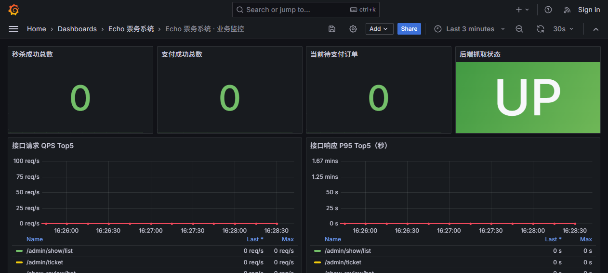

# Echo 监控栈（Prometheus + Grafana）

本机二进制方式部署，不依赖 Docker。抓取 `localhost:8081` 的 Spring Boot Actuator 指标，Grafana 面板自动装配。

```
后端 echo-backend :8081  /actuator/prometheus
        │  每 30s 抓取
        ▼
Prometheus :9090   ──── 查询 ────▶  Grafana :3000  (面板 uid: echo-dashboard)
```

| 组件 | 版本 | 地址 | 数据目录 |
|---|---|---|---|
| Prometheus | 2.53.1 | http://localhost:9090 | `prometheus-data/` |
| Grafana | 11.1.0 | http://localhost:3000 | `grafana-data/` |

Grafana 登录 `admin / admin`；同时开了匿名 Editor（`GF_AUTH_ANONYMOUS_ENABLED=true`），直接打开链接就能看。

## 启动 / 停止

```bat
start-monitor.bat     :: 幂等，已在跑的服务自动跳过
stop-monitor.bat      :: 只停进程，数据保留
```

改完 `prometheus.yml` 不用重启，热重载即可（启动时带了 `--web.enable-lifecycle`）：

```bash
curl -X POST http://localhost:9090/-/reload
```

改面板只要改 `dashboards/echo-dashboard.json`，Grafana 每 10 秒扫描一次自动生效。

## 目录说明

| 路径 | 作用 |
|---|---|
| `prometheus.yml` | 抓取配置：30s 间隔，目标 `localhost:8081/actuator/prometheus` |
| `dashboards/echo-dashboard.json` | 面板定义（14 个图），uid `echo-dashboard` |
| `grafana-provisioning/datasources/datasource.yml` | 自动注册 Prometheus 数据源，uid `prom-echo`，设为默认 |
| `grafana-provisioning/dashboards/dashboard-provider.yml` | 自动扫描 `dashboards/` 目录加载面板 |
| `prometheus-data/` `grafana-data/` | 时序数据 / Grafana 元数据库，别删 |
| `prometheus-2.53.1.windows-amd64/` `grafana-dist/` | 二进制本体 |
| `dashboard-screenshot.png` | 面板实拍图，效果见下 |



## 面板都查了什么

| 面板 | PromQL 要点 |
|---|---|
| 秒杀成功 / 支付成功 / 待支付 / 积分拦截 | `sum(_total)`、`order_pending_current` |
| 后端抓取状态 | `up{job="echo-backend"}`，1=UP 0=DOWN |
| 接口 QPS Top5 | `topk(5, sum by (endpoint) (rate(api_request_duration_seconds_count[2m])))` |
| 接口响应 P95 Top5 | `topk(5, max by (endpoint) (api_request_duration_seconds{quantile="0.95"}))` |
| 下单 / 秒杀 / 支付 P95·P50 | `xxx_duration_seconds{quantile="0.95"}` |
| Redis 补偿、座位清理耗时 | `xxx_duration_seconds_max`（summary 自带的近峰值） |
| JVM 堆内存 | `sum(jvm_memory_used_bytes{area="heap"}) / 1048576` |
| 业务事件速率 | `sum(rate(xxx_total[5m])) * 60`，换成每分钟 |

## 两个必须知道的坑（都是实际踩到的）

**1）这些耗时指标是 `summary`，不是 `histogram`，别用 `histogram_quantile`。**

后端用 Micrometer 打的 `summary`，导出的是 `_count` / `_sum` / `_max`，一部分还带客户端算好的分位标签：

```
order_create_duration_seconds{module="ticket-order",quantile="0.95"} 0.0
order_create_duration_seconds_count{module="ticket-order"} 0.0
```

所以正确写法是直接取分位标签 `{quantile="0.95"}`。
写 `histogram_quantile(0.95, rate(xxx_bucket[5m]))` 或 `quantile(0.95, sum by (le)(...))` 会永远查不到数据——`_bucket` 序列根本不存在。

不过**不是所有 summary 都带分位**。带 `quantile` 标签的只有：
`api_request_duration_seconds`、`order_create_duration_seconds`、`payment_process_duration_seconds`、`seckill_process_duration_seconds`。

其余的（`redis_compensation_*`、`seat_cleanup_*`、`order_timeout_*`、`pre_order_compensation_*`、`seckill_order_*`、`seckill_reconcile_*`、`state_transition_*`）只有 `_count`/`_sum`/`_max`，面板里改用 `_max` 看近峰值。若确实要它们的 P95，得在代码里给对应 `Timer` 加 `.publishPercentiles(0.5, 0.95)`。

**2）不要轻易改 target 的 labels。**

Prometheus 用完整标签集标识一条序列。给 target 加/改一个 label，等于凭空多出一条新序列，旧的要等 5 分钟 staleness 才消失。这段重叠期里 `sum(xxx_total)` 会把同一个计数器算两遍，数字翻倍。改完标签最好等 5 分钟再看数。

## 换 Docker 部署时注意

容器里 Prometheus 的 `localhost:8081` 指的是容器自己，抓不到宿主机后端。要改成
`host.docker.internal:8081`，Linux 上还得补 `extra_hosts: ["host.docker.internal:host-gateway"]`。
